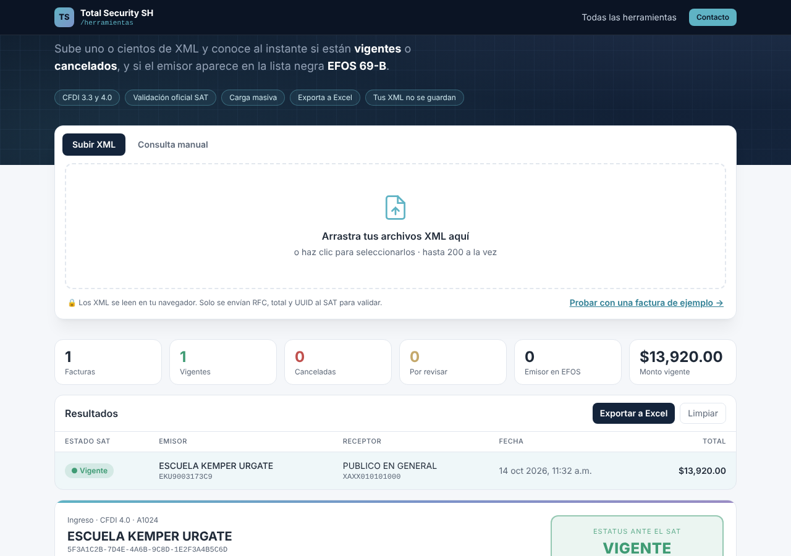
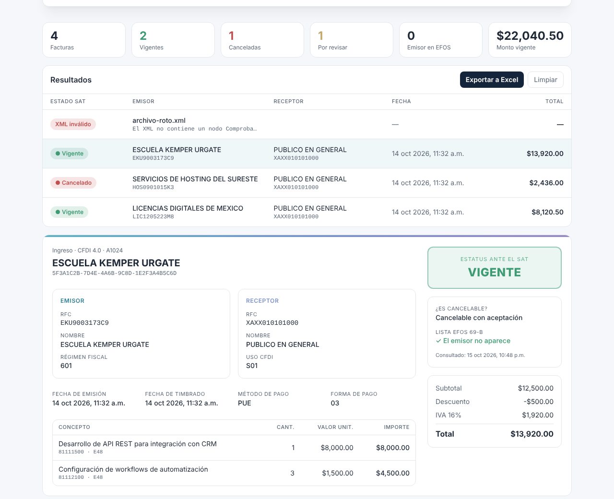

<div align="center">

# 🧾 CFDI Lector

**Lee y valida tus facturas CFDI ante el SAT, gratis y sin guardar tus archivos.**

Sube uno o cientos de XML o PDF y conoce al instante si están **vigentes** o **cancelados**,
y si el emisor aparece en la lista negra **EFOS 69-B**.

[](https://nextjs.org)
[](https://www.typescriptlang.org)
[](https://tailwindcss.com)
[](https://vercel.com)

🌐 **[herramientas.totalsecuritysh.com/cfdi](https://herramientas.totalsecuritysh.com/cfdi)**



</div>

## ✨ Funcionalidades

| | |
|---|---|
| 📂 **Carga masiva** | Arrastra hasta 200 XML a la vez (CFDI 3.3 y 4.0). Detecta duplicados por UUID. |
| 📄 **También PDF** | Lee el código QR de la representación impresa (UUID, RFCs, total y sello). Si el QR no se puede leer, extrae los datos del texto del PDF. |
| ✅ **Validación oficial** | Consulta el servicio público de verificación de CFDI del SAT: *Vigente*, *Cancelado* o *No encontrado*. |
| 🚩 **Lista EFOS 69-B** | Indica si el emisor aparece en el listado de empresas que facturan operaciones simuladas. |
| 🔎 **Detalle completo** | Emisor, receptor, conceptos, impuestos trasladados y retenidos, totales, fechas y timbre. |
| ✍️ **Consulta manual** | Valida sin XML, solo con RFC emisor, RFC receptor, total y UUID. |
| 📊 **Exportar a Excel** | Descarga el resultado de todas las facturas en CSV compatible con Excel. |
| 🔒 **Privacidad** | El XML o PDF se lee en el navegador. Al servidor solo viajan RFC, total, UUID y 8 caracteres del sello. |
| 🌓 **Modo claro / oscuro** | Responsivo y adaptado al tema del sistema. |



## 🏗️ Arquitectura

```
Navegador                                   Vercel (serverless)                 SAT
─────────                                   ───────────────────                 ───
XML ──► DOMParser (lib/cfdi.ts) ─┐
PDF ──► pdf.js + jsQR (lib/pdf.ts)┤
                                  └─ RFC, total, UUID, sello ──POST──► /api/sat (route.ts)
                                             ├─ validación de formato
                                             ├─ límite por IP
                                             └─ SOAP ConsultaCFDIService ─────► Estado · EFOS
◄────────────── JSON estatus ◄───────────────┘
```

- **`src/lib/cfdi.ts`**: lector de CFDI 3.3 / 4.0 independiente de namespaces.
- **`src/lib/pdf.ts`**: renderiza el PDF con pdf.js, busca el QR del SAT con jsQR y, si no lo encuentra, lee los datos del texto.
- **`src/lib/sat.ts`**: cliente SOAP del servicio de consulta del SAT con reintentos y timeout.
- **`src/app/api/sat/route.ts`**: endpoint con validación de entradas y rate limit.
- **`src/components/cfdi/CfdiApp.tsx`**: interfaz y consultas en paralelo (concurrencia 3).

### Multi-zones
Esta herramienta es una **zona** del hub [`tsh-herramientas`](https://github.com/TotalSecurity-SH/tsh-herramientas). Se publica con `basePath: "/cfdi"` en su propio proyecto de Vercel, y el hub la sirve bajo `herramientas.totalsecuritysh.com/cfdi` mediante *rewrites*. Así cada herramienta vive en su propio repo y lenguaje, pero el usuario ve una sola plataforma.

> El SAT no permite llamadas directas desde el navegador (CORS), por eso la consulta pasa por una función serverless.

## 🚀 Correr en local

```bash
git clone https://github.com/TotalSecurity-SH/cfdi-lector.git
cd cfdi-lector
npm install
npm run dev
```

Abre http://localhost:3000/cfdi y da clic en **"Probar con una factura de ejemplo"**.

Para desarrollar sin conexión al SAT, usa respuestas simuladas:

```bash
SAT_MOCK=1 npm run dev
```

## ☁️ Desplegar en Vercel

1. Importa el repositorio en [vercel.com/new](https://vercel.com/new).
2. Framework: **Next.js** (se detecta solo). No requiere variables de entorno.
3. **Deploy**. Queda en `https://<proyecto>.vercel.app/cfdi`.
4. En el hub, la variable `CFDI_URL` apunta a esa URL.

## ⚠️ Aviso

Herramienta independiente, **sin relación con el SAT**. Usa el servicio público de verificación de CFDI; su disponibilidad depende del SAT. La factura de ejemplo es ficticia y usa el RFC de pruebas del SAT.

<div align="center">

Hecho por **[Carlos Santiago](https://carlossantiago.totalsecuritysh.com)** · [Total Security SH](https://totalsecuritysh.com) · Full Stack Developer · IA y Automatización

</div>
